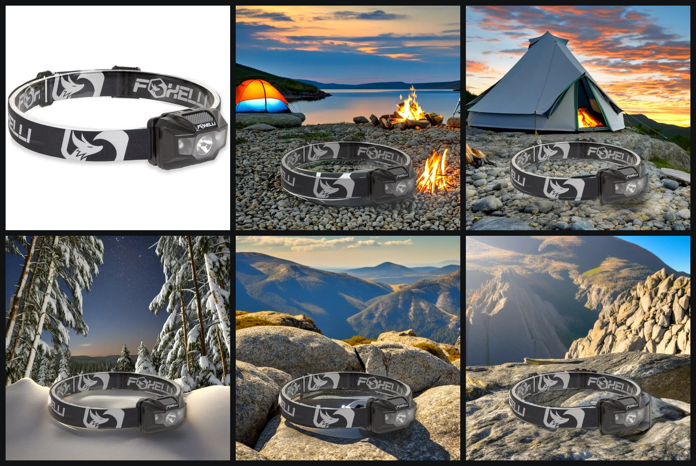
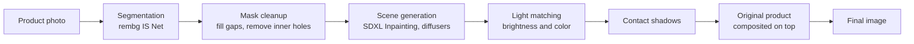
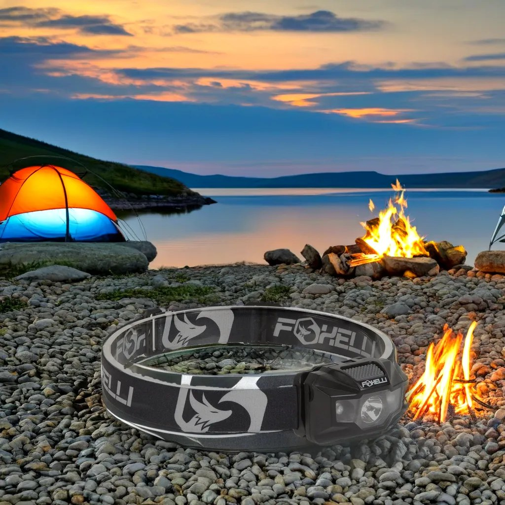
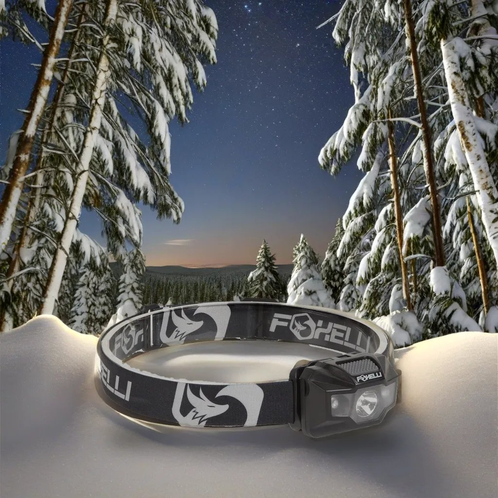
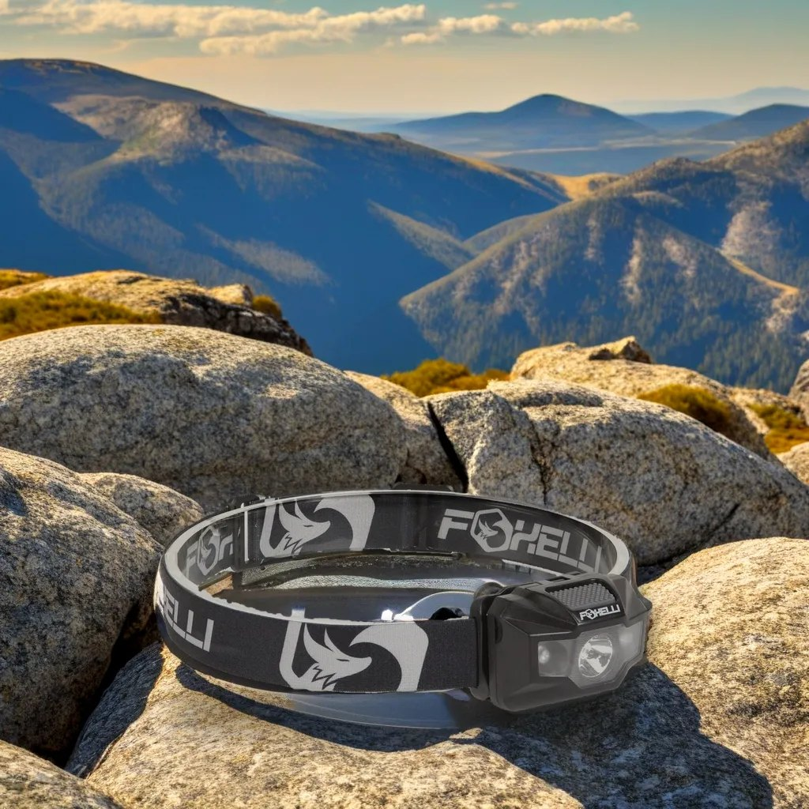
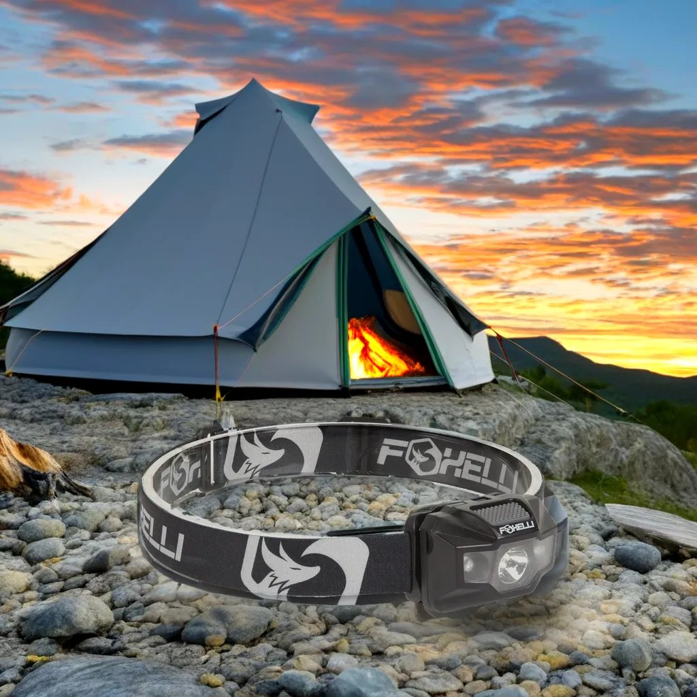
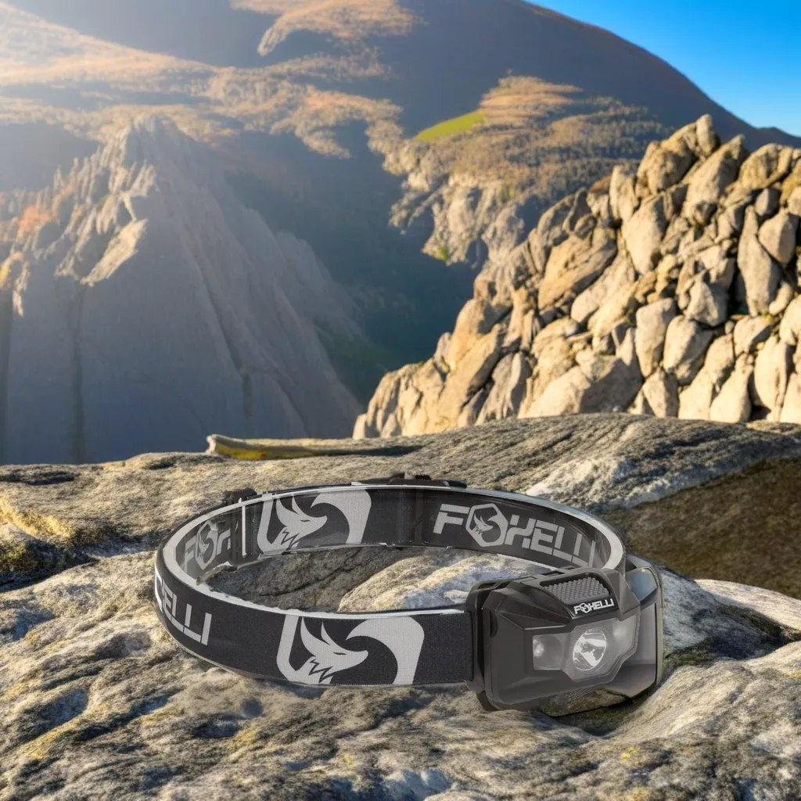
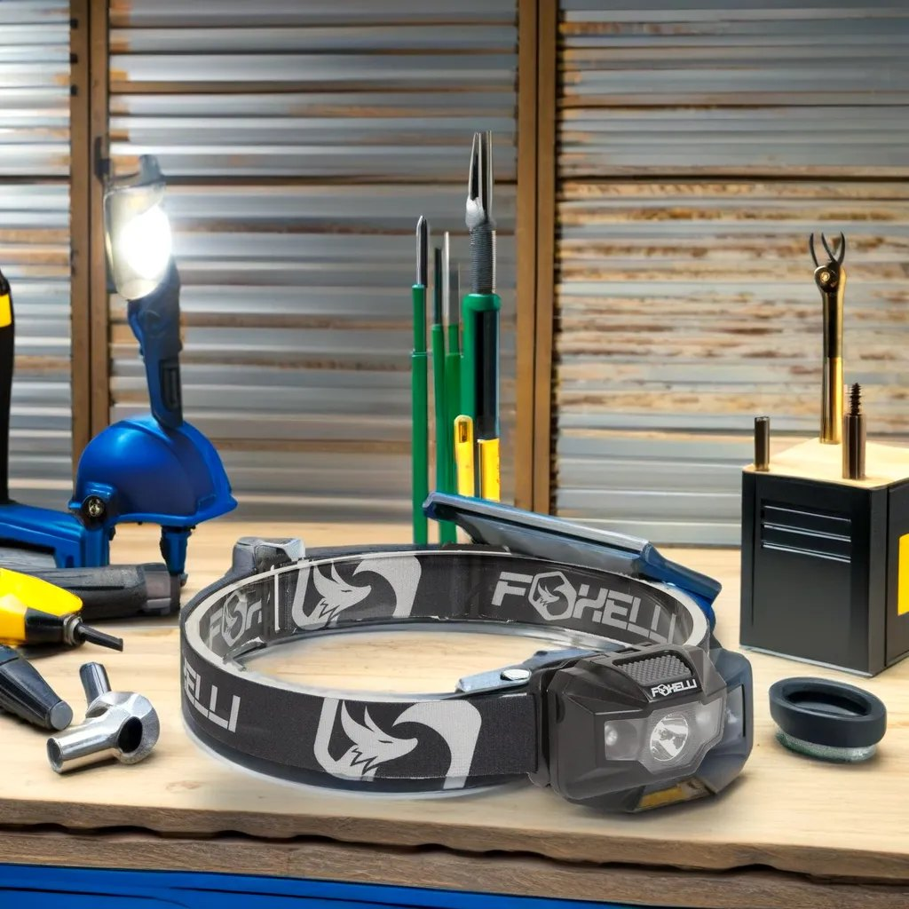

# Product Photo Studio

**One product photo in, ready to use lifestyle scenes out, without ever redrawing the product.**

An AI pipeline for ecommerce brands that turns a single studio shot into ad and marketplace images. The product's pixels, logo and colors are never regenerated, so the brand stays exactly as it is.

Runs end to end on a free Google Colab T4 GPU with open source models. Cost per image: **$0**.

*Top left: the original studio photo. Everything else: generated scenes with the same untouched product.*

---

## Why this matters

Brands that sell on Amazon and Shopify need many images per product: listing photos, seasonal variants, ad creatives for every channel. Photo shoots are slow and expensive. Generic image models are fast but **redraw the product**, which breaks logos, text and colors. Brands can't publish that.

This pipeline keeps the product pixel perfect and only generates the world around it.

## How it works

1. **Segmentation.** `rembg` with the IS Net model cuts out the product.
2. **Mask cleanup.** Faded or semi transparent areas are filled so the product is solid. Large enclosed white regions (like the inside of a headband loop) are removed, and a 1 px edge trim removes white halos.
3. **Scene generation.** Stable Diffusion XL Inpainting through Hugging Face `diffusers` generates the scene. Two modes:
   * **Clean background:** the full scene is generated first, then the product is placed. Nothing can "grow" out of the product.
   * **Blend:** the scene is inpainted around the product for tighter integration.
4. **Light matching.** The product's highlights are matched to the scene's brightness, and it picks up a little of the scene's color (warm at sunset, blue at night), so a studio lit product doesn't glow in a night scene.
5. **Shadows.** A wide soft shadow plus a contact shadow that follows the product outline, so it sits on the surface instead of floating.
6. **Compositing.** The original product is pasted back on top. The logo is never touched by the generative model.

## Engineering decisions

| Problem found while testing | Fix |
|---|---|
| Generated models redraw logos and text | Never let diffusion touch the product. Composite the original pixels last |
| Inside of the headband loop stayed white | Detect large enclosed near white regions and remove them from the mask |
| Parts of the strap looked see through | Fill holes in the alpha mask so the product is fully solid |
| Product looked like it was floating | Contact shadow that follows the product shape, plus "lying flat directly on" prompts |
| Studio lit product too bright in dusk scenes | Match the product's 90th percentile brightness to the scene and add a light color tint |
| Washed out, foggy backgrounds | Random color noise instead of flat gray as the starting image, stronger negative prompt, light contrast and color boost |
| Extra parts generated inside the loop | Clean background mode generates the scene without the product |
| Black images with SDXL in fp16 | fp16 safe VAE (`madebyollin/sdxl-vae-fp16-fix`) |

## Results

| | |
|---|---|
|  |  |
|  |  |
|  |  |

## Run it yourself (free)

1. Open `Product_Photo_Studio.ipynb` in [Google Colab](https://colab.research.google.com).
2. **Runtime > Change runtime type > T4 GPU**.
3. **Runtime > Run all.** The session restarts once after installing packages.
4. **Runtime > Run all** again, then open the `gradio.live` link.

The notebook installs and verifies its own dependencies, runs a health check before launching, and shows the time per image in the app.

## Stack

Python · PyTorch · Hugging Face Diffusers · Stable Diffusion XL Inpainting · rembg (IS Net) · NumPy / SciPy · Pillow · Gradio · Google Colab

## What I'd build next

* **IP Adapter** to keep a consistent brand style across a whole catalog.
* **ControlNet (depth)** for perspective that matches the product angle.
* **Relighting** (for example IC Light) for physically correct light on the product.
* **Automatic quality checks**: CLIP similarity to confirm the product is intact, and a vision LLM to reject weak scenes.
* **Batch mode** for full catalogs, served with **FastAPI** and a **Next.js** UI, using **Fal / Replicate / RunPod** serverless GPUs for scale.
* **Image to video** to turn the best stills into short ad clips.

---

*The product photo is used for demonstration only. This project is not affiliated with the brand shown.*
